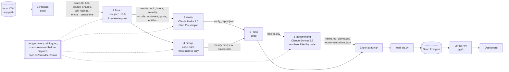

# Spotify Review Insight Pipeline (multi-agent)

Turns 660,622 Spotify Google Play reviews (May 2022 – Nov 2023) into a product-priority recommendation where every
number traces to saved calculations and source reviews. Code owns record accounting, budgets, validation and
arithmetic; models only answer bounded language questions.

**Live dashboard:** https://spotify-review-dashboard-eta.vercel.app (public, no login).
**Recommendation:** prioritise **playback** next quarter, starting with `playback.general` — see [outputs/final/memo.md](outputs/final/memo.md).

## Results summary

| | Value | Evidence |
|---|---|---|
| Source rows ingested and accounted for | 660,622 / 660,622 (0 missing, 0 duplicate IDs) | [grading/ingestion.json](grading/ingestion.json), official checker |
| Classified (declared scope) | **100,000** completed, 0 enrichment failures | [grading/records.jsonl.gz](grading/records.jsonl.gz) |
| Quarantined | 13 `empty_review_text` + 560,609 `not_classified_outside_declared_budget_scope` | same |
| Exact-text cache reuse | 21,901 records reuse a validated result via direct `cache_source_id` (78,099 distinct texts sent) | checker: `valid_cache_reuses` |
| Golden-50 agreement (human) | topic 0.70 · intent 0.88 · severity exact 0.76, MAE 0.30 · sentiment ±0.5 0.84 | [evals/golden_error_analysis.md](evals/golden_error_analysis.md) |
| Independent verifier (n = 781, blind) | topic 0.83 · intent 0.90 · severity exact 0.81, MAE 0.22 | [outputs/final/verify_report.json](outputs/final/verify_report.json) |
| Final run cost / time | **$2.93** API spend · 2 h 44 min wall clock (1 worker) | [grading/calls.jsonl.gz](grading/calls.jsonl.gz), [grading/recording/](grading/recording/) |
| Total spend incl. all development runs | ≈ **$3.45** (cap: $10) | table below |
| Official self-check | `review_required` with **one** expected flag: `unfinished_classification` (560,609 out of scope). Coverage point candidate **0.4908** | `check_submission.py check` |

Measured values and estimates are kept separate: everything above is measured; projections live only in
[cost/report.md](cost/report.md). "Accounted for" ≠ "classified": only 100,000 of 660,609 nonempty reviews were
classified (a budget decision, see Limitations).

## Rubric → evidence map

| Rubric item | Where to look |
|---|---|
| **Deliverable 1** — accessible code/setup/artifacts | Setup + commands below; `requirements.txt`; `.env.example`; all outputs committed |
| **Deliverable 2** — architecture, shared schema, provenance | [Architecture](#architecture); `pipeline/labels.py` (labels + `label_config`); `source_sha256` per record; `pipeline/config.py` (models, rates, caps) |
| **Deliverable 3** — memo numbers linked to calculations | Memo numbers are inserted by code from `ranking.csv` (`{C#}` placeholders, `pipeline/memo.py`); `grading/claims.csv` passes the checker's `claim_mismatch` test |
| **Deliverable 4** — recommendation, alternatives, limitations | [outputs/final/memo.md](outputs/final/memo.md); [Limitations](#limitations) |
| **Testing 1** — 50 human labels, per-field comparison, error analysis | `evals/golden_50_labeled.csv`, `evals/golden_results.{json,csv}`, [evals/golden_error_analysis.md](evals/golden_error_analysis.md) |
| **Testing 2** — independent verification, planted error, injection | `pipeline/verify.py`; `outputs/final/verify_report.json`; `evals/system_tests.py` → `evals/system_tests.json` (all passed) |
| **Testing 3** — 100-review cold/warm pilot, offline calculator, retry/spend/recovery controls | [cost/](cost/) (`python -m cost.calculator`), `tests/`, `pipeline/ledger.py`, interruption evidence in `grading/recording/` |
| **Working 1** — ingestion, coverage, classification | `grading/` export; official checker coverage table above |
| **Working 2** — staged program, bounded calls, saved handoffs, resume | `pipeline/run.py`; 1 review per Jev request; per-batch commits; `grading/checkpoint_{before,after}.json` + logs |
| **Working 3** — reproducible ranking + deployed dashboard/backend/DB + AI recommendations | `python -m pipeline.run --rank-only …`; dashboard URL above; `dashboard/` (Vercel API) + Neon Postgres (`pipeline/load_db.py`) |

## Architecture



| Stage | Owner | Input → output | Failure behaviour / stop condition |
|---|---|---|---|
| 1 Prepare | code | CSV → `reviews` table, ingestion report | Refuses to overwrite saved state; malformed CSV aborts |
| 2 Enrich | Jev (`system_one`, 3 `Choice` questions) + code | pending distinct texts → `results` | Invalid output retried once, API errors 3× with backoff, then quarantined with reason; stops at spend cap; saves every 50 texts; Ctrl-C/SIGTERM save and exit |
| 3 Verify | Claude Haiku 4.5 (structured output) | declared 1% random sample, text only → `verify` table, disagreement report | Returned IDs must equal sent IDs; invalid output retried once |
| 4 Group | code (keyword rules → `topic.subtopic`); Haiku names issues from ≤5 quotes each | complaint/cancellation records → `membership.csv`, `issues.json` | Model cannot add/merge issues; naming failure keeps code names |
| 5 Rank | code | membership + severities → `ranking.csv` | Deterministic; duplicate memberships rejected |
| 6 Recommend | Claude Sonnet 5.5 | ranking top 10 + overall metrics + evidence pack (5 issues × 3 quotes) → memo | Model writes `{C1}` / `{M:key}` placeholders, never digits; code fills values and rejects unknown issues/IDs, typed numbers, unsupported business claims; one feedback round, then the stage fails visibly |

**Why each model call exists:** Jev answers the three fixed-choice questions per review (cheapest bounded classifier,
$0.042 per 1M input tokens, output free). Haiku re-labels a sample independently and names issues (cheap language
judgment). Sonnet writes one memo per run: on the 500-review checkpoint the Haiku memo passed the code checks but
mislabeled metrics and reasoned weakly, so the memo role alone was upgraded (≈$0.02–0.05 per memo).
**What code does instead:** parsing, hashing, deduplication, scope selection, sentiment (derived from intent
probabilities), evidence quotes (exact substrings), entities (keyword matching), validation, grouping, all arithmetic,
ranking, claim values, budgets, retries, logging and export.

## One review, end to end

`366ee65a-e272-427c-80d5-8a83b26f84f8` — *"Stopped working I have to keep on installing and unistalling the app to make it work"* (1★, 2023-11-03)

1. **Source:** `source_sha256 = cbffd3b6…3656a8`; in the declared 100k scope.
2. **Enrichment:** Jev request `local-9e252bf1e898409f` (phase `resume`, 787 input tokens) → topic **playback** (p = 0.90), intent **complaint** (p = 0.97), severity **4**; code: sentiment −1.0, evidence quote = full text (≤200 chars), `needs_review = false`.
3. **Verification:** in the blind 1% sample; Haiku request `req_011Cg7G5Jd8d6rjDbFhNKnTj` → playback / complaint / 4 (exact agreement).
4. **Issue membership:** `playback.general` (no more specific playback rule matched) in `grading/membership.csv`.
5. **Ranking:** `playback.general` is rank 4: 2,846 complaints, severity sum 10,208, mean 3.586788.
6. **Memo claim:** claims C1–C3 (`playback.general` count, severity sum, mean) support the recommendation to prioritise playback.
   Try it on the dashboard: paste the ID into **Trace a review**.

**Failed / ambiguous case:** *"Update: I reached out to Spotify Support and with some help from Sarah I was able to get the app working again. Old Post: Normally, the app works great…"* — human label support/request/1; pipeline playback/complaint/4. The enricher labeled the superseded old complaint. Handling: recorded as an enricher error in the golden error analysis; not corrected by hand. Non-English reviews (4 golden cases) are labeled confidently by Jev instead of being routed to `unclear`; recorded as a limitation.

## Baseline ranking rules

Complaint and cancellation records only; one issue per review (`allow_multi_issue: false`).
`complaint_count` = members, `severity_sum` = Σ severity, `mean_severity` = sum / count (6 dp, half-up),
`priority_score` = `severity_sum`. Order: score desc, then `issue_id` asc. Regenerate with no model calls:

```sh
python -m pipeline.run --rank-only --db data/work/state.db --out outputs/final
```

## Setup

```sh
python3 -m venv .venv && .venv/bin/pip install -r requirements.txt
cp .env.example .env      # fill only TYPESAFE_API_KEY, ANTHROPIC_API_KEY, DATABASE_URL locally; never commit .env
```

Place the course dataset in `data/raw/` (not committed; [Drive link from the assignment](https://drive.google.com/file/d/1P0rUoAS_wVjp3BYKqXMEyD4u0uJP1Bvf/view)).
Source: BwandoWando, *3.4 Million Spotify Google Store Reviews* v2 (Kaggle, CC0). Full CSV SHA-256
`1fc85de68a304dd8978b537cfa58793d5f41cbaf417fa32cb53899f83a2fcef6`.

## Commands

| Purpose | Command | Paid? |
|---|---|---|
| Estimate any run (dry run) | `python -m pipeline.run <csv> --db data/work/x.db --scope all --out outputs/x` | no |
| Run all stages | add `--execute` (and `--grading grading` to export) | **yes** |
| Final run as executed | `scripts/interrupt_demo.sh` then `scripts/resume_final.sh` | **yes** |
| Re-rank from saved outputs | `python -m pipeline.run --rank-only --db data/work/state.db --out outputs/final` | no |
| Cost calculator, offline replay | `python -m cost.calculator` | no |
| 100-review pilot (cold + warm) | `python -m cost.calculator pilot --execute` | **yes** |
| Golden evaluation | `python scripts/export_golden.py && python -m evals.golden_eval --db data/work/state.db` | no |
| System tests | `python -m evals.system_tests` (add `--execute` for the paid injection/planted-error part) | optional |
| Offline tests (fake models) | `python -m tests.test_pipeline_offline && python -m tests.test_calculator_offline` | no |
| Load dashboard DB | `python -m pipeline.load_db --db data/work/state.db --out outputs/final` | no |
| Official self-check | `python3 check_submission.py check --reference local-reference.json --submission grading --out self-check.json` | no |

Paid stages run only with `--execute`; spend caps: $5 per provider, $5 per run (`pipeline/config.py`), 1 worker.

## Runs and spend

| Run | Reviews | Spend | Notes |
|---|---|---|---|
| Jev smoke test | 1 | <$0.001 | connectivity |
| 100-review pilot, cold + warm | 100 | $0.027 (warm $0) | `cost/` — warm run: 0 new enrichment and 0 Claude calls |
| Claude smoke test | 2 | $0.001 | before the pilot |
| 500 checkpoint | 500 | $0.111 | Haiku memo drafts rejected by code checks → placeholder design |
| System tests | 3 synthetic + 10 copies | $0.006 | `evals/system_tests.json` |
| 10k checkpoint | 10,000 | $0.373 | `outputs/analysis10k/` |
| **Final run** | **100,000** | **$2.935** | enrich $2.59 · verify $0.25 · memo $0.07 (2 rejected drafts) · group $0.02 |
| **Total** | | **≈ $3.45** | |

The pilot-based projection for the 100k run was $2.87 (base) / $3.43 (conservative); actual $2.93.
Rates: [cost/rates.csv](cost/rates.csv) (dated sources). Local compute is reported as unknown, not zero.

## Interruption and resume (final run)

`grading/recording/01_initial_then_interrupt.log` → `02_resume.log` (timestamped terminal transcripts).
The initial run labeled 3,950 distinct texts (18,390 review IDs incl. exact duplicates) and was then stopped. A
SIGINT sent from a background script was ignored (non-interactive jobs inherit SIGINT as ignored), so the process was
terminated with SIGTERM — effectively a crash. One in-flight paid call (≈$0.00003) was lost and redone on resume.
`checkpoint_before.json` (18,390 IDs) ⊂ `checkpoint_after.json` (100,000 IDs); the resume phase sent 74,149 new
texts and **0** already-completed IDs (checker: no `reprocessed_checkpoint`, no `resume_call_evidence` flags).
`pipeline/run.py` now converts SIGINT and SIGTERM into a graceful stop.

## Limitations

- **Coverage:** only 100,000 of 660,609 nonempty reviews were classified (a deterministic uniform sample by
  SHA-256 of seed + ID, which contains the golden 50 and the 10k analysis set). Unclassified rows are quarantined with
  an explicit reason and reduce the coverage score; findings describe the sample, not every review.
- **Catch-all issue:** `other.general` ranks #1 (13,743 complaints) because generic complaints have no specific topic.
  The memo treats it as non-actionable; splitting it is a recommended next step.
- **Label quality:** topic boundaries (usability vs. other/catalog/billing) are the least consistent; severity 5 is
  occasionally over-scored (0.5% of records); non-English text is labeled confidently rather than routed to review;
  `needs_review` (confidence < 0.5) over-flags. See the golden error analysis.
- **Golden revision:** the human severity column was revised once after the first evaluation (scale mix-up); disclosed
  in the error analysis.
- **Data:** self-selected, historical public reviews; no revenue, plan tier, churn or population data. Cancellation
  language is expressed intent, not observed churn. Timestamps have no timezone; first and last months are partial.
- **Dashboard DB role:** the API uses the Neon owner role with read-only queries; a dedicated read-only role would be
  safer.

## Dashboard access

https://spotify-review-dashboard-eta.vercel.app — public. Backend endpoints (JSON): `/api/summary`, `/api/issues`,
`/api/issue?id=<issue_id>`, `/api/review?id=<review_id>`. Data loaded from `outputs/final` + `data/work/state.db` into
Neon Postgres (`dashboard/schema.sql`). The recommendation text on the page is the Sonnet output with numbers filled
in by code; claim chips open the supporting reviews.
